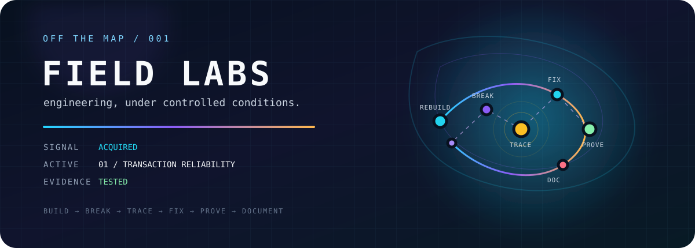
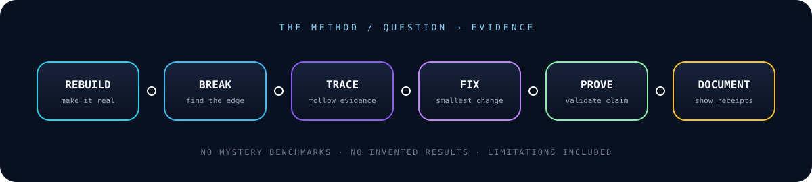

 

**Real engineering problems. Rebuilt from scratch. Broken on purpose. Measured honestly.**

[ENTER THE LAB BENCH](#-the-lab-bench) · [READ THE METHOD](#-the-method) · [BROWSE THE CATALOG](labs/)

---

## ◈ OFF THE MAP

Field Labs started with a simple thought while looking through the kinds of problems people hire engineers to solve:

> ### **I could build that.**

So I started doing it.

Not by copying someone else's work, and not by pretending a tutorial is production experience. Field Labs takes the **engineering idea behind a real-world problem**, rebuilds it from scratch with synthetic data, and turns it into a controlled experiment.

Some labs stay small. Some turn into deeper investigations. Every lab exists for the same reason:

**Build the thing. Find the edge cases. Understand what breaks. Prove what changed.**

<strong>▸ What Field Labs is not</strong>

 

It is not a collection of client clones, copied job postings, production data, mystery benchmarks, or polished demos pretending to be battle-tested systems.

The problem is the inspiration. The implementation and evidence are built here from scratch.

---

## ⌁ THE METHOD

A useful Field Lab has a narrow question, a reproducible baseline, an intentionally triggered failure when appropriate, an improvement, and evidence showing what changed.

> **LAB RULE 00:** If it hasn't been measured, it isn't presented as a result.

---

# ⌬ THE LAB BENCH

All twenty-two current labs have implemented slices. Their individual READMEs define the evidence, scope, and limitations for each experiment.

| ID | Experiment | Engineering focus |
| :-- | :-- | :-- |
| **[01](labs/01-transaction-reliability/)** | **Transaction Reliability** | Duplicate requests, concurrency, and idempotency |
| **[02](labs/02-ai-workflow-boundaries/)** | **AI Workflow Boundaries** | Deterministic software and bounded AI interpretation |
| **[03](labs/03-email-delivery-verification/)** | **Email Delivery & Verification** | Generation, provider acceptance, and delivery evidence |
| **[04](labs/04-web-session-reliability/)** | **Web Session Reliability** | Concurrent refresh and authentication state |
| **[05](labs/05-document-annotation/)** | **Document Annotation** | Keeping annotations anchored through changing views |
| **[06](labs/06-verified-document-pipeline/)** | **Verified Document Pipeline** | Verifying generated document data and serialized artifacts |
| **[07](labs/07-offline-event-check-in/)** | **Offline Event Check-In** | Offline acceptance, reconciliation, and idempotent replay |
| **[08](labs/08-ai-product-discovery/)** | **AI Product Discovery** | Semantic retrieval bounded by authoritative catalog facts |
| **[09](labs/09-bounded-api-retries/)** | **Bounded API Retries** | Retry classification, replay safety, backoff, and bounded retry budgets |
| **[10](labs/10-circuit-breaker-recovery/)** | **Circuit Breaker Recovery** | Failure isolation, recovery timeout, and bounded probe admission |
| **[11](labs/11-bulkhead-isolation/)** | **Bulkhead Isolation** | Partitioned concurrency limits and saturation containment |
| **[12](labs/12-token-bucket-rate-limiting/)** | **Token Bucket Rate Limiting** | Burst admission, refill accounting, and bounded request rates |
| **[13](labs/13-request-deadline-budgeting/)** | **Request Deadline Budgeting** | End-to-end deadlines, downstream timeout bounds, and reserved completion time |
| **[14](labs/14-cooperative-cancellation/)** | **Cooperative Cancellation** | Cancellation propagation, abandoned work, and bounded detection delay |
| **[15](labs/15-load-shedding/)** | **Load Shedding Under Saturation** | Bounded admission, queue capacity, and overload rejection |
| **[16](labs/16-graceful-degradation/)** | **Graceful Degradation** | Required dependencies, optional capabilities, and reduced response modes |
| **[17](labs/17-request-coalescing/)** | **Request Coalescing** | Duplicate in-flight demand and bounded downstream work |
| **[18](labs/18-stale-cache-fallback/)** | **Stale Cache Fallback** | Freshness boundaries, bounded stale delivery, and revalidation intent |
| **[19](labs/19-hedged-requests/)** | **Hedged Requests** | Bounded duplicate admission, race outcomes, and timeline consistency |
| **[20](labs/20-adaptive-concurrency-limits/)** | **Adaptive Concurrency Limits** | Bounded feedback, window aggregation, controller state, and stabilization |
| **[21](labs/21-stable-request-routing/)** | **Stable Request Routing** | Deterministic rendezvous routing, membership churn, and ownership inspection |
| **[22](labs/22-retry-budgets/)** | **Retry Budgets** | Proportional retry admission, deterministic windows, and inspectable policy decisions |

[**BROWSE THE FULL LAB CATALOG →**](labs/)

---

## ⌁ EVIDENCE, NOT VIBES

Field Labs separates **what I expect** from **what I can demonstrate**.

| Evidence | What it proves |
| :-- | :-- |
| **Reproduction** | The failure can actually be triggered under known conditions. |
| **Automated tests** | Behavior can be checked repeatedly instead of judged by appearance. |
| **Measurements** | Performance or reliability claims have observed numbers behind them. |
| **Failure injection** | The system is tested when assumptions stop being true. |
| **Limitations** | The experiment says exactly where its conclusions stop applying. |

A green test is evidence for a claim. It is **not** a magic production-ready stamp.

---

## ⛨ LAB PROTOCOL

<strong>01 // Synthetic by default</strong>

 
Fixtures, identities, transactions, documents, companies, products, and events are fabricated for the experiment.

<strong>02 // The original work stays original</strong>

 
Field Labs may be inspired by broad engineering problems seen in the market, but client work, job-posting content, proprietary implementations, private systems, employer material, and other non-public information do not belong here.

<strong>03 // Failure belongs in the artifact</strong>

 
A lab is allowed to start broken. The interesting part is making the failure reproducible, understanding it, and proving the improvement.

<strong>04 // Show the receipts</strong>

 
Tests, measurements, tradeoffs, and limitations matter more than a polished screenshot with no explanation behind it.

---

### `BUILD → BREAK → TRACE → FIX → PROVE → DOCUMENT`

**FIELD LABS // THE WORK IS THE EVIDENCE**

[AGENTS](AGENTS.md) · [CONTRIBUTING](CONTRIBUTING.md) · [SECURITY](SECURITY.md)

